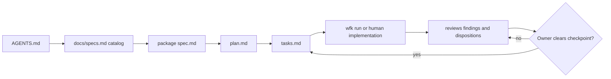

# agent-workflow-kit

A small, standard-library Python toolkit for running a spec-first coding
workflow across Windows, macOS and Linux. It creates and audits package records,
manages Git worktrees, runs bounded agent tasks, installs cleanup hooks and
copies reusable VS Code prompts.

Requirements: Git 2.38 or newer and Python 3.10 or newer. The Python kit needs
no PowerShell. This checkout's optional [Spec Kit scripts](docs/workflow-core.md#create-a-package)
use PowerShell 7 separately.

## Install

Clone the kit, then add its `bin` directory to `PATH`. The `wfk` launcher
works from any repository and selects a suitable Python interpreter.

```console
git clone --branch main git@github.com:lyubomir-popov/agent-workflow-kit.git
export PATH="/path/to/agent-workflow-kit/bin:$PATH"
wfk --help
```

On Windows, add the kit's `bin` directory to the user `PATH` through
Environment Variables or the shell you use, then run `wfk --help`.

Without changing `PATH`, run `python -m wfk` from the kit checkout:

```console
python -m wfk --help
```

The kit does not install Python packages. Consumer repositories keep their own
`.workflow-kit.json` and workflow files; `wfk init` can add missing files.

## Main commands

Mutating commands preview by default where they offer `--apply`. Review the
preview before repeating the command with `--apply`.

| Command | Example | What it does |
|---|---|---|
| `wt new` | `wfk wt new feat/example --from main` | Creates a linked worktree at the configured or sibling worktree root. |
| `wt ls` | `wfk wt ls --root ../projects --size` | Discovers registered worktrees, landed branches and scratch-root orphans. |
| `wt clean` | `wfk wt clean --root ../projects` | Previews eligible cleanup; add `--apply` to remove through Git. |
| `run` | `wfk run --repo . --package specs/003-example --agents codex --json` | Previews a bounded package run. Add `--apply` to dispatch. |
| `lint` | `wfk lint --repo . --json` | Checks workflow ownership, links, gates, reviews and budgets offline. |
| `new` | `wfk new search-export --repo .` | Previews a numbered package and branch; add `--apply` to create them. |
| `init` | `wfk init --repo .` | Previews missing workflow files; add `--apply` to create only missing paths. |
| `hooks` | `wfk hooks install --repo .` | Previews composed post-merge/post-rewrite cleanup hooks; add `--apply` to install. |
| `prompts` | `wfk prompts install` | Previews VS Code and Insiders prompt copies; add `--apply` to install or replace them. |

Replace the example paths and package name with entries from your own repository.

`wt new` creates immediately because it has no `--apply` mode. `wt clean`
is a preview until `--apply`; it never removes protected, dirty, locked,
unlanded, current or primary worktrees. Read its warning about ignored files
before applying cleanup.

`init --apply` uses exclusive creation: existing files are preserved byte for
byte and returned in a manual merge checklist. It does not install hooks, prompts
or worker CLIs.

A scheduler execution requires one or more explicit `--package` selections and
`--apply`. CLI permission flags only let an already authorized worker operate;
they do not clear package checkpoints, extend repository scope or authorize
publishing.

## Workflow



The catalog routes to a package on its declared branch. The package spec owns
intent and checkpoints, the plan owns approach, tasks own execution, and
`reviews/` keeps the evidence. Reviewers save findings to files; only the owner
clears checkpoints. A checkpoint receives at most two review rounds before the
owner accepts, cuts scope or reopens the plan.

## Reference

- [Workflow ownership and adoption](docs/workflow-core.md)
- [Worktree discovery, cleanup and hooks](docs/worktrees.md)
- [Scheduler profiles, outcomes and recovery](docs/scheduler.md)
- [Terminal, authentication and operational practice](docs/operations.md)
- [Enforcement guarantees and gaps](docs/enforcement.md)
- [Compatibility for repositories still using the retired PowerShell kit](docs/legacy-compatibility.md)

Reusable prompts inherit the model already selected by the invoking host.
Automated scheduler reviews instead use the configured reviewer profile; the
shipped default is Copilot with `claude-opus-4.8`.

The repository config format is version 2. Python commands can inspect a version
1 config and name fields they ignore, but runtime behavior is strict about
unsupported versions. Repositories that still require the retired PowerShell
implementation must use a separate checkout pinned to `v1-powershell`; the tag
alone does not move shared consumers.

The committed GitHub Actions workflow is configured to run the Python suite,
CLI help and lint on Windows, macOS and Linux. That configuration is not evidence
that a remote workflow has run or that branch protection requires it.
